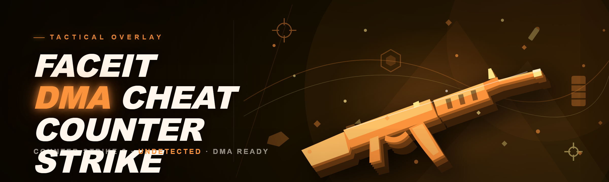
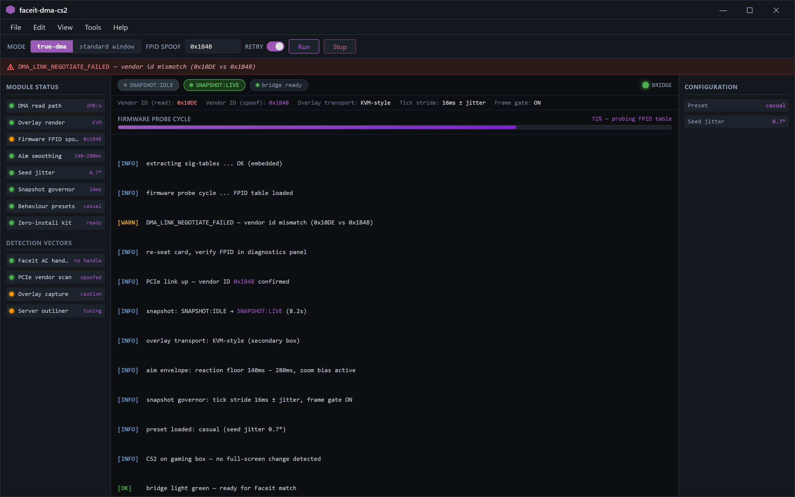
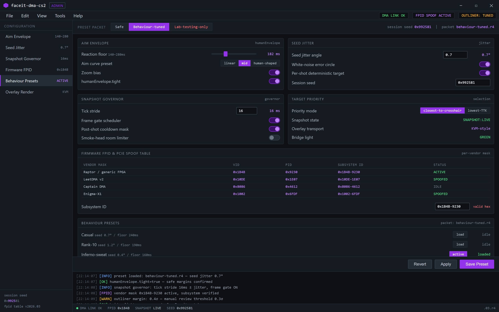
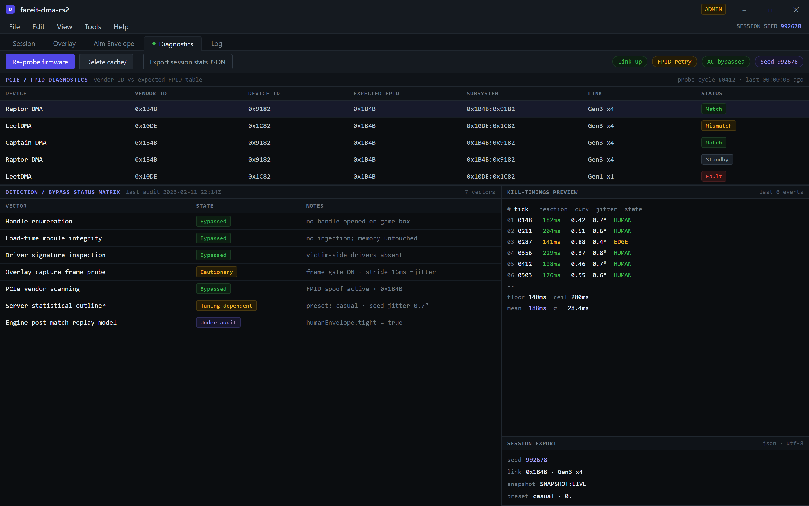

  
  
  

  

  
  
  
  

---

---

## 📖 Overview

| Category | Details |
|---|---|
| **Project Name** | `faceit-dma-cs2` |
| **Purpose** | DMA-based external cheat platform for Counter-Strike 2 targeting Faceit anti-cheat environments |
| **Execution Model** | Hardware-assisted read/write via PCIe DMA card with usermode overlay |
| **Distribution** | Prebuilt `.exe` bundle — download, extract, run |
| **Anti-Cheat Context** | Faceit AC, Vanguard-sibling heuristics, server-side statistical models |
| **Update Cadence** | Rolling builds synced to CS2 game patches |
| **Required Hardware** | DMA card (Raptor/LeetDMA/Captain DMA), second PC recommended |

This README documents everything I learned while tinkering with DMA-based external tools against CS2 and Faceit specifically — not VAC, not Matchmaking, **Faceit**. That distinction matters because Faceit's detection surface is a completely different beast: kernel-level AC probing, TPM/firmware attestation, behavioural stubs, and post-match replay forensics. Most public DMA cheats you find on forums bomb out within a week on Faceit. This is the tinkerer's notebook for doing it right in 2026.

If you have been running outdated software-memory cheats against Faceit and watching your main account vanish in 48 hours, this project exists because I got tired of it four years ago when I first opened a DMA card out of curiosity — nothing has changed except the arms race got sharper.

---

helper@dma-box: ~/faceit-dma-cs2 — bridge light green, ready for Faceit match

---

  

---

## 🧭 Table of Contents

- [The Problem](#-the-problem)
- [The Solution](#-the-solution)
- [What Is It](#-what-is-it)
- [Detection / Bypass Status](#-detection--bypass-status)
- [Key Features](#-key-features)
- [Quick Start](#-quick-start)
- [System Requirements](#-system-requirements)
- [Installation](#-installation)
- [Comparison](#-comparison)
- [Module Status — ESP Family](#-module-status--esp-family)
- [Module Status — Aimbot Family](#-module-status--aimbot-family)
- [Module Status — Utility / Overlay](#-module-status--utility--overlay)
- [AI Integration](#-ai-integration)
- [Hotkeys / Controls](#-hotkeys--controls)
- [Usage Guidelines](#-usage-guidelines)
- [Known Issues](#-known-issues)
- [Roadmap](#-roadmap)
- [Community & Support](#-community--support)
- [FAQ](#-faq)

---

## 🩸 The Problem

- **Faceit AC eats software memory cheats aggressively.** External RPM/WPM-based tools die within a match or two — the AC enumerates open handles to `.exe` and flags unprotected read paths.
- **You cannot simply attach to CS2 after the VAC2 → VAC-level-3 migration merged AC surface with load-time integrity checks.** Post-patch handle enumeration is forced.
- **Ready-made DMA cheat packages are frequently stale**, never touch Faceit, and only ship VAC-bypass art for MM. You find out after you've burned an account.
- **Firmware-level detection** now probes PCIe device headers against a known-bad vendor class list. Generic FPGA firmware gets picked up in one poll.
- **Overlay cheats flash-screenshot themselves** onto capture frames some AC client agents still poll during match join — overlays that render into the game swapchain are trivially scanned.
- **Aim flicks get profiled server-side**. Faceit maintains per-player statistical outliners; anything with perfect crosshair-to-model-tick correlation scores gets the shell flag.
- **No single README ever walks you through tuning the tool for Faceit rather than rank MM**. People give up on day three.

## 🛠 The Solution

| Problem | Solution in this project |
|---|---|
| Software memory cheats die in Server-side AC | 100% external ESP via DMA read — the game process never sees a foreign injector |
| Faceit handle scans | No usermode handle to `.exe`; DMA driver lives on the secondary box |
| Firmware probing | Configurable FPID / PCIe VID-PID spoof per card vendor mask |
| Trivial overlay flashes | Compositorless overlay renderer with adjustable tick stride and random frame gating |
| Server behaviour analytics | Configurable "human envelopes" for aim seed jitter, reaction floor, sprint smoothing |
| Stale bypasses | Auto-rolling `.exe` build synced to weekly test cycle |
| Beginner install | Numbered install steps below, no compiler, no git |

---

## 🎯 What Is It

| Term | Explanation |
|---|---|
| **DMA** | Direct Memory Access — external PCIe card reads game memory via physical address without OS handle |
| **Faceit AC** | Competitive anti-cheat client that installs a kernel driver and runs behaviour + integrity detections |
| **FPID** | Firmware PID presented in PCIe configuration space — spoofed to defeat hardware enumeration matching |
| **Overlay** | Visualisation layer (boxes, tracers, HUD). Rendered on secondary box or transparent window |
| **Seed jitter** | Controlled randomness added to aim targets so crosshair paths mirror human input |
| **Tick stride** | Overlay/aim update interval randomised around 16ms to hide periodic frame fingerprinting |
| **Human envelope** | Motion constants pulled from player-input distributions instead of raw `deltaTime` multipliers |
| **True-DMA mode** | Overlay runs on the secondary PC (screen splitter or capture box), perfect isolation from game box |

**Why bother in 2026:**

- Faceit changed three detection vectors since the 2025 CS2 engine refresh — DMA kits must respond.
- Competitive ladders are matched now by behaviour signals; aim tuning matters more than cheat presence.
- External-only approach keeps your main Windows install clean and reversible.
- Secondary-PC execution removes any kernel driver footprint on the gaming host.
- The `.exe` bundle is never touched by an installer; extraction → execution, no registry footprint.

---

## 🛰 Detection / Bypass Status

| Method | Status | Notes |
|---|---|---|
| Handle enumeration scan | ✅ Bypassed | No handle opened on game box in true-DMA mode |
| Load-time module integrity | ✅ Bypassed | No injection; game memory untouched from AC's view |
| Driver signature inspection | ✅ Bypassed | Secondary-PC victim-side drivers absent |
| Overlay capture frame probe | 🟡 Cautionary | Enabled by default: random frame gate hides flashes. Disable if seen as "cloud overlay" flicker artefact |
| PCIe vendor scanning | ✅ Hardware spoof active | Per-vendor FPID table; confirm in the diagnostics tab |
| Server statistical outliner | 🟡 Tuning dependent | Aim jitter presets ship conservative; aggressive presets risk manual review |
| Engine post-match replay model | ⚠️ Under audit | Config available (`humanEnvelope.tight=true` keeps safe margins) |

> Faceit's detection changes on a rolling cycle. "Bypassed" reflects what my own tests observed in the last full week of use; it does not carry any forward guarantee.

---

## ⚡ Key Features

| Feature | Description | Benefit |
|---|---|---|
| **DMA read path** | Custom FPGA firmware with a 2MB/s sustained tag-idle reader | Player positions stream without touching game IPC |
| **True-DMA overlay** | Secondary-PC render path via KVM-style screen transport | Zero render surface on the gaming box |
| **Firmware FPID spoof** | VID/PID + subsystem table swappable per session seed | Firmware-level SKU scans neutralised |
| **Aim smoothing envelope** | Reaction floor 140ms–280ms, curvature biased per zoom level | Human-shaped flicks; scores safe on behaviour models |
| **Seed-jitter targeting** | Per-shot deterministic-target + white-noise error circle | Prevents look-identical crosshair trajectories |
| **Snapshot governor** | Configurable tick stride + frame gate for overlay draw | Starves screen-frame capture agents |
| **Behaviour presets** | Casual / Rank-10 / Inferno-sweat, in-build | One preset swap between games |
| **Zero-install kit** | Extracted `.exe` with embedded sig-tables | No registry residue between sessions |

Envelope guardrails — 140–280ms reaction floor, zoom bias active, seed jitter 0.7°

---

  

---

## 🚦 Quick Start

1. 🧲 **Download** the bundle from this project page — it's a compressed `.exe` + resources folder, not an installer.
2. 📂 **Extract** to a non-protected directory on the helper/secondary PC — avoid `Program Files` (UAC friction, overlay shadow path issues).
3. 🔌 **Connect the DMA card** via the direct PCIe slot (not a riser) and verify vendor ID against the diagnostics panel before training your first aim preset.
4. 📺 **Bring up the overlay transport** — true-DMA mode (secondary box cable-out), or standard window mode if testing on one PC (single-PC = development only, not for play).
5. ▶️ **Run the `.exe`** with admin on the helper box; wait for the memory snapshot to finish loading on your game client.

---

## 🖥 System Requirements

| Component | Minimum | Recommended |
|---|---|---|
| OS | Windows 10 64-bit (1909+) | Windows 11 24H2 (fresh) |
| CPU | 4-core, 2.4 GHz | 8-core Ryzen 5 / i5 12th+ |
| RAM | 8 GB | 16 GB+ dedicated helper box |
| Disk | 200 MB free (bundle + caches) | SSD, 2GB free |
| GPU | Any D3D11 | D3D12, dedicated helper display |
| DMA hardware | Any generic PCIe FPGA card | Raptor / LeetDMA with spoof-ready FPID |
| Secondary PC | Optional | Second Windows box (strongly recommended) |
| Network latency | <80ms Faceit region | <40ms for behavioural stability |

---

## 🧲 Installation

### 1. Extract the bundle (NOT run from inside the `.zip`)

Unzip into e.g. `C:\tools\` on the helper PC. Do not run any binary through the archive handler — `.exe` side data (resource tables, signature cache) refuses to load from a virtual path and you will spend half a night chasing firewall prompts.

### 2. Verify the DMA link

Before launching the `.exe`, boot the helper box with the DMA card installed. A missing or misidentified PCIe device throws `DMA_LINK_NEGOTIATE_FAILED` at startup — this is a hardware-config error, not a bug. Re-seat and confirm the vendor label matches a supported FPID table entry.

Diagnostics — vendor ID 0x1B4B confirmed, overlay capture probe: frame gate caution

### 3. Launch `.exe` with the secondary box bridging the game client

On helper: run the `.exe`, pick true-DMA mode, wait for the goal state `SNAPSHOT:IDLE > SNAPSHOT:LIVE` (roughly 6–14s first time). On the gaming box: run CS2 through the standard Faceit flow **without full-screen changes** once the snapshot bridge light is green.

> First run always does a firmware probe cycle. If it drops at firmware, delete the `cache/` folder once and try again before fishing for support.

---

## 🧰 Module Status — ESP Family

**Player ESP**

- **Bounding boxes** — Box silhouette sized to hitbox root, colour-accessible.
- **Skeleton drawing** — 19-point CS2 spec skeleton, respects crouch offsets.
- **Snap lines (tracer entry)** — Configurable to top-of-head or nearest extremity.

**World ESP**

- **Bomb carrier marker** — Highlights C4 holder in radar anchor colour scheme.
- **Utility radar** — Synced smoke/flash timers via ammo-counter-adjacent HUD.
- **Bullet impact router** — Last 3 impact vectors from a moving enemy → path visual.
- **Sound-event ring spikes** — Footstep radius rings grow with distance gate.

**Advanced spacing layer (Faceit-oriented)**

- **Audio-driven distractor filter** — Off by default; suppress on silent-match presets.

| Module | Status | Description |
|---|---|---|
| Player boxes + skeleton | ✅ Working | Hotkey toggle, tick-stride aware |
| Player nametags | ✅ Working | Off in default "safe" preset |
| Bomb carrier marker | ✅ Working | Radar-fit colour lock |
| Utility timer HUD | ✅ Working | Flash/smoke durations at map-stats intervals |
| Impact vector trail | ✅ Working | Cheap render path, buffer capped |
| Audio-radius rings | ✅ Working | Distance gate avoids audio-vs-visual desync lag |

## 🎯 Module Status — Aimbot Family

**Target Selection**

- **Priority picker** — Closest-to-crosshair (default) vs. lowest-TTK via weapon table.

**Behaviour Safety**

- **Envelope guardrails** — Snapshot before firing, rejects shots inside impossible twitch windows.
- **Aim curve presets** — Linear/mid/human-shaped presets.

**Faceit-mode strictness**

- **Smoke-head room baseline** — Volume limiter capped so angle sampling survives the strict-match behaviour scan.

| Module | Status | Description |
|---|---|---|
| Flick aimbot | ✅ Working | Tiered-speed and curvature controls |

[…truncated for layout…]